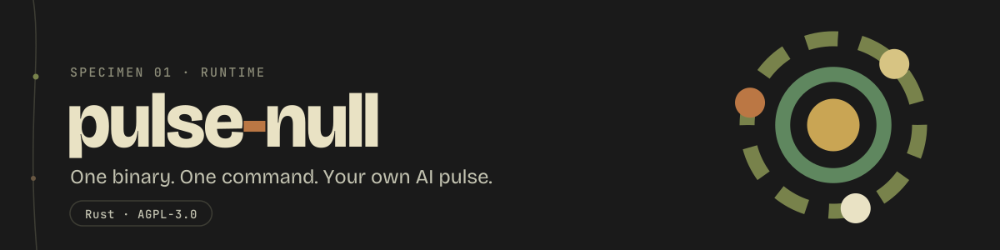

<p align="center">
  
</p>

<p align="center">
  <a href="https://github.com/dnacenta/pulse-null/releases"></a>
  <a href="https://github.com/dnacenta/pulse-null/actions/workflows/ci.yml"></a>
  
  <a href="https://pulse-null.com"></a>
  <a href="LICENSE"></a>
</p>

<p align="center">
  One binary. One command. Your own AI pulse.
</p>

A pulse is a long-running AI agent with its own directory: identity documents, a journal,
a four-layer memory ([recall-echo](https://github.com/dnacenta/recall-echo)), a schedule
and an intent queue. `pulse-null` creates pulses and runs them. The model does the
thinking, through an agent CLI you already have (Claude Code, Grok, Codex) or an API;
pulse-null keeps what that thinking leaves behind. Each pulse is a daemon with a local
HTTP API and a terminal UI. Discord and phone calls are optional plugins.

It is a research scaffold, not a consciousness claim.

## Install

Rust 1.89 or newer. Build from source; crates.io still holds an old 0.22.0.

```sh
cargo install --locked --git https://github.com/dnacenta/pulse-null
```

Add `--features all-plugins` for Discord text and voice. Then a brain: an agent CLI with
a login on the machine (`claude`, `grok`, `codex`), an Anthropic API key, or Ollama.

## Quick start

```sh
mkdir -p ~/pulse-null && cd ~/pulse-null
pulse-null init              # wizard: name, owner, brain, timezone, plugins → ./<name>/
cd <name>
pulse-null chat              # talk to it in the terminal
pulse-null up --headless     # or run it as a daemon (systemd)
```

## Docs

- [Concepts](docs/concepts.md): what a pulse has and how the pieces fit
- [Pulses](docs/pulses.md): layout, brains and adapters, several pulses per user
- [Commands](docs/commands.md) · [Configuration](docs/configuration.md)
- [Terminal UI](docs/tui.md) · [HTTP API](docs/http-api.md): routes, security, plugins
- [Troubleshooting](docs/troubleshooting.md)

## Contributing

[CONTRIBUTING.md](CONTRIBUTING.md). The CI gate is `scripts/gate.sh` (fmt, clippy
`-D warnings`, tests).

## License

GNU Affero General Public License v3.0 only. Copyright (C) 2026 Daniel Nacenta.
